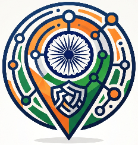
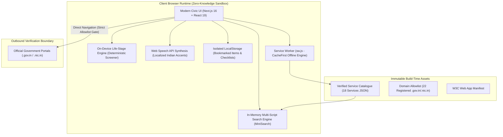

<div align="center">

  

# GovEase

### _An India-First, Zero-Knowledge Civic Navigation Architecture_

**An independent, dated public-benefit directory guiding citizens directly to official government portals.**

[](#10-academic-context--authorship)
[](https://nextjs.org/)
[](https://www.typescriptlang.org/)
[-orange.svg?style=flat-square>)](#3-cross-platform--app-support)
[](#8-test-suite--quality-assurance)
[](#8-test-suite--quality-assurance)
[](#-notice-proprietary-academic-capstone--not-for-cloning-or-redistribution)
[](SECURITY.md)

</div>

---

> [!CAUTION]
>
> ### 🛑 NOTICE: PROPRIETARY ACADEMIC CAPSTONE — NOT FOR CLONING OR REDISTRIBUTION
>
> **This repository is published strictly for academic capstone presentation, jury examination, and portfolio review by authorized evaluators.**
>
> - **Strict No-Clone Policy:** Direct cloning, scraping, re-hosting, mirroring, or creating public derivatives of this codebase is **strictly prohibited**.
> - **Original Intellectual Property:** All architecture definitions, civic decision matrices, on-device algorithms, design tokens, and catalogue data structures represent original intellectual work engineered by **Anirban Chatterjee**.
> - **Plagiarism & Commercial Prohibition:** Submitting this project (in whole or in part) as another person's academic work or using it for commercial monetization, cyber-cafe syndication, or white-labeling is strictly forbidden.

---

> [!IMPORTANT]
> **Independent Public Technology Initiative & Academic Notice**  
> This platform is an **independent, public-benefit civic discovery and navigation guide** engineered as a **3rd Year B.Tech Computer Science & Engineering Capstone Project**. It is **not** an official application of the Government of India, is not affiliated with, authorised by, or endorsed by any government ministry or department, and does not claim official status. All outbound links direct users strictly to verified, official government portals (`.gov.in` and `.nic.in`).

---

## 1. Executive Summary & Problem Space

In modern India, essential public services—ranging from civil registration, health accounts (ABHA), and pensions to driver licensing, student scholarships, and disability smart cards—are distributed across dozens of disparate central and state portals. Citizens, particularly first-time digital users and rural communities, face systemic hurdles:

1. **Information Fragmentation:** Multiple overlapping portals, obsolete unofficial blogs, and phishing clones competing in search engine results.
2. **Commercial Surveillance & Data Harvesting:** Intermediary cyber-cafes and commercial portals harvesting citizen Aadhaar numbers, phone numbers, and documents.
3. **Linguistic & Accessibility Barriers:** Dense bureaucratic jargon, lack of regional language parity, and poor assistive technology compatibility.

**GovEase** addresses these challenges through a **Zero-Knowledge, client-side, privacy-preserving civic navigation engine**. It provides a verified, dated directory of **18 essential public life services** across **6 core domains**, accompanied by 5-phase sequential guides, an on-device eligibility screener, assistive audio narration, and an instant multi-script search engine.

---

## 2. Core Architecture & Engineering Highlights



### Key Technical Innovations:

- **Zero-Knowledge Privacy Architecture:** Strictly zero backend database, zero telemetry, zero analytics tracking, and zero commercial tracking cookies. Conforms to the **Digital Personal Data Protection (DPDP) Act, 2023** and **DPDP Rules 2025**.
- **100% In-Memory Search Engine:** Powered by `minisearch` running entirely in the user's browser thread. Delivers **100.0% Top-1 accuracy** across 210 benchmark queries covering Devanagari Hindi, phonetic transliterations, acronyms, and common typos.
- **Deterministic Life-Stage Engine:** Matches citizen demographic profiles (farmers, students, unorganised workers, senior citizens, PwD) to verified schemes through a pure functional decision matrix with zero network roundtrips.
- **Offline-First Progressive Web App (PWA):** Fully functional offline with pre-cached application shell, static service snapshots, and background service worker (`sw.js`).
- **Multilingual Regional Parity:** Complete dictionary parity across **English**, **हिंदी (Hindi)**, **বাংলা (Bengali)**, and **தமிழ் (Tamil)** with script-tailored font stacks and typographical ascender clearance.

---

## 3. Cross-Platform & App Support

This platform is engineered using modern web standards as a **Universal Progressive Web App (PWA)**, allowing seamless installation across desktop and mobile platforms without separate native app stores:

| Platform            | Native Integration                                       | Installation Mechanism                                      | Offline Capability          |
| :------------------ | :------------------------------------------------------- | :---------------------------------------------------------- | :-------------------------- |
| **Windows 11 / 10** | Desktop window, Taskbar pin, Start Menu, Window controls | Install via Microsoft Edge or Google Chrome ("Install App") | 100% Offline Shell & Search |
| **macOS**           | Native Dock icon, standalone window frame                | Install via Google Chrome or Safari                         | 100% Offline Shell & Search |
| **Android**         | WebAPK, App Drawer icon, full-screen standalone mode     | Add to Home Screen via Chrome / Firefox                     | 100% Offline Shell & Search |
| **iOS / iPadOS**    | Standalone home screen web app, splash screen            | "Add to Home Screen" via Safari                             | 100% Offline Shell & Search |
| **Linux**           | Desktop entry, system application menu                   | Chromium / Edge / Brave PWA installation                    | 100% Offline Shell & Search |

> [!TIP]
> **Desktop & Mobile App Packaging (Tauri / Electron / Capacitor):**  
> Because the codebase compiles to a pure, decoupled static export (`output: "export"` in `next.config.ts`), the build artifacts in `/out` can be packaged directly into a native Windows `.exe` / `.msi` via **Tauri**, a macOS `.dmg`, or an Android `.apk` / iOS `.ipa` via **Capacitor** with zero backend code refactoring.

---

## 4. Verified Service Catalogue (18 Services across 6 Domains)

Every service in the catalogue is verified against official gazette notifications and domain records. Intermediary fees, third-party brokers, and unallowlisted domains are strictly forbidden.

| Domain                       | Verified Official Services                                                                                                                                                                                                                                              | Primary Official Portal                                                                                                      |
| :--------------------------- | :---------------------------------------------------------------------------------------------------------------------------------------------------------------------------------------------------------------------------------------------------------------------- | :--------------------------------------------------------------------------------------------------------------------------- |
| **Healthcare & Well-Being**  | • Ayushman Bharat Health Account (ABHA ID)<br>• Ayushman Bharat PM-JAY Health Coverage<br>• CoWIN Official Vaccine Certificate Verification                                                                                                                             | `abdm.gov.in`<br>`beneficiary.nha.gov.in`<br>`cowin.gov.in`                                                                  |
| **Education & Scholarships** | • National Scholarship Portal (NSP OTR) & Central Schemes                                                                                                                                                                                                               | `scholarships.gov.in`                                                                                                        |
| **Finance & Welfare**        | • PM Jan Dhan Yojana (PMJDY Basic Bank Account)<br>• e-Shram Worker Registration & National UAN<br>• PM Suraksha Bima Yojana (PMSBY)<br>• PM-Kisan Samman Nidhi & Farmer eKYC<br>• EPF Passbook & UAN Claim Tracking<br>• National Food Security Act (NFSA Ration Card) | `pmjdy.gov.in`<br>`eshram.gov.in`<br>`jansuraksha.gov.in`<br>`pmkisan.gov.in`<br>`passbook.epfindia.gov.in`<br>`nfsa.gov.in` |
| **Citizen & Legal Identity** | • Civil Registration System (CRS Birth & Death Registration)<br>• DigiLocker Cloud Storage & Digital Verifications<br>• Unique Disability ID (UDID Smart Card for PwD)<br>• Official Permanent Account Number (PAN) Reprint                                             | `crsorgi.gov.in`<br>`digilocker.gov.in`<br>`swavlambancard.gov.in`<br>`onlineservices.nsdl.com`                              |
| **Mobility & Transport**     | • Driving Licence Renewal & Endorsement (Parivahan Sarathi)<br>• Vehicle RC Ownership Transfer (Parivahan Vahan)                                                                                                                                                        | `sarathi.parivahan.gov.in`<br>`parivahan.gov.in`                                                                             |
| **Public Consumer Rights**   | • National Consumer Helpline (NCH 1915) Grievance Redressal                                                                                                                                                                                                             | `consumerhelpline.gov.in`                                                                                                    |

---

## 5. Security & Privacy Model

The application adheres to an uncompromising, multi-layered security model detailed in [`SECURITY.md`](SECURITY.md) and [`docs/architecture/SECURITY_CONTROL_MAPPING.md`](docs/architecture/SECURITY_CONTROL_MAPPING.md):

- **Zero Credential Capture (Hard Rules):** Under no circumstance does the platform request, handle, store, or transmit Aadhaar numbers, Aadhaar biometrics, OTPs, banking passwords, or UPI PINs.
- **Public Domain Allow-List:** Outbound links are strictly restricted to 22 pre-verified government root domains (`.gov.in` and `.nic.in`) validated at build time via `catalogue/domain-allowlist.json`.
- **Hardened Content Security Policy (CSP):**
  ```http
  Content-Security-Policy: default-src 'self'; script-src 'self' 'unsafe-inline'; style-src 'self' 'unsafe-inline'; img-src 'self' data: https:; font-src 'self' data:; connect-src 'self'; frame-ancestors 'none';
  ```
- **Anti-Leak Client Sanitizer:** Input sanitization engine (`src/lib/anti-leak-sanitizer.ts`) scrubbing potential PII patterns (Aadhaar 12-digit formats, 6-digit OTPs, PAN cards) before executing client-side searches.
- **On-Device Data Transparency:** Dedicated `/settings` portal presenting an audit of every local storage byte with a one-click permanent purge mechanism.

---

## 6. Advanced Civic Utilities & Zero-Cost Architecture

GovEase incorporates high-utility citizen assistance modules operating with **zero infrastructure cost ($0 / ₹0)** and zero server-side telemetry:

1. **In-Browser Civic Document Prep Studio (`/prep-studio`):**
   - Automatically resizes, crops, and compresses applicant photos and signature scans to exact government portal byte budgets (e.g., 20 KB – 50 KB for UPSC, SSC, and Parivahan).
   - Operates 100% in local browser RAM using offscreen HTML5 Canvas. Zero bytes ever leave the client device, achieving strict DPDP Act 2023 compliance.

2. **Composite Multi-Service "Life Event" Journeys (`/journeys`):**
   - Chains individual services into sequential, dependency-aware milestone workflows with verified prerequisites:
     - **Newborn Child in Family:** CRS Birth Certificate $\rightarrow$ Blue Baal Aadhaar $\rightarrow$ Infant ABHA Health ID.
     - **Higher Education & Employment:** DigiLocker Records $\rightarrow$ National Scholarship Portal $\rightarrow$ PAN Card $\rightarrow$ Voter e-EPIC.
     - **Informal & Gig Worker Safety Net:** e-Shram 12-digit UAN $\rightarrow$ PM Jan Dhan Zero-Balance Account $\rightarrow$ PMSBY Accidental Cover.
     - **Senior Citizen Dignity:** EPF Pension Settlement $\rightarrow$ Senior Citizen Ayushman Bharat $\rightarrow$ National Consumer Grievance.
   - Includes on-device milestone tracking with progress indicators and local state persistence.

3. **Smart Voice Search via Web Speech Recognition API:**
   - Enables hands-free civic discovery with microphone voice search in Hindi, English, Bengali, and Tamil.
   - Features animated soundwave feedback and graceful fallback for browsers without speech recognition.

4. **Emergency Helplines & Anti-Scam SMS Header Verifier (`/help`):**
   - **One-Tap Statutory Helplines:** Offline dialers for 1930 (Cybercrime Golden Hour), 1915 (Consumer Helpline), 14555 (Ayushman Bharat), 1947 (UIDAI Aadhaar), and 14443 (e-Shram).
   - **TRAI Alphanumeric SMS Verifier:** Validates incoming SMS headers against registered government departments (e.g. `AX-PARIVH`, `VK-UIDAI`, `CPGRAM`) and immediately flags personal 10-digit mobile numbers as high-risk phishing scams.

5. **Statutory Tariff & Grace Period Penalty Calculator:**
   - Implements Section 15 of the Motor Vehicles (Amendment) Act 2019 and CMVR Rule 32 to dynamically calculate driving licence renewal grace periods and statutory late fees.
   - Transparently highlights official costs (₹50 PAN reprint, ₹0 e-Shram, ₹0 child biometrics) against inflated market tout charges.

6. **Common Service Center (CSC) Statutory Rate Charter:**
   - Publishes MeitY maximum fee schedules (₹5 print, ₹10 scan, ₹0 Ayushman card) to protect rural and semi-urban citizens against cyber-cafe extortion.
   - Includes direct links to authorized CSC and Aadhaar Seva Kendra locators.

7. **Instant QR Code Cross-Device Synchronization:**
   - Generates compact, compressed QR codes (`?sync=id1,id2`) allowing instant peer-to-peer bookmark transfer between mobile devices and desktop computers without user accounts or cloud storage.

8. **State & UT Civic Resolver:**
   - Bridges central initiatives with state-administered services across 20 Indian states and union territories, routing citizens directly to verified state subdomains.

---

## 7. Repository Organization

The repository is organized following clean architectural boundaries:

```text
Gov Project/
├── .github/                      # CI/CD Workflows (GitHub Actions)
│   └── workflows/
│       ├── ci.yml                # Vitest, Type-check & Linter pipeline
│       └── deploy.yml            # Static export & production deploy
├── catalogue/                    # Authoritative Service Catalogue Data
│   ├── schema/                   # JSON Schema definitions
│   ├── services/                 # 18 individual verified service definitions
│   └── domain-allowlist.json     # Allowlisted .gov.in & .nic.in domains
├── docs/                         # Formal Project Documentation
│   ├── architecture/             # System Architecture, Threat Model, Design System
│   │   ├── DESIGN_SYSTEM.md
│   │   ├── IMPLEMENTATION_LEDGER.md
│   │   ├── KNOWN_ISSUES.md
│   │   ├── SECURITY_CONTROL_MAPPING.md
│   │   └── THREAT_MODEL.md
│   ├── reports/                  # Audits & Verification Reports
│   │   ├── ACCESSIBILITY.md      # WCAG 2.2 AA Audit Log
│   │   ├── PERFORMANCE_REPORT.md # Lighthouse & Performance Budgets
│   │   ├── QA_REPORT.md          # Multi-Tier Quality Report
│   │   └── RELEASE_CHECKLIST.md  # Production Verification Gate
│   ├── decisions/                # Architectural Decision Records (ADRs 0001–0010)
│   ├── catalogue/                # Catalogue Governance & Link Health Reports
│   ├── integrations/             # Official Provider Access Specifications
│   ├── security/                 # Vulnerability Tracking & Threat Analysis
│   └── screenshots/              # Visual Regression & Showcase Artifacts
├── e2e/                          # Playwright End-to-End Test Suite (66 tests across 6 viewports)
├── public/                       # Static Public Assets, PWA Icons & Service Worker
│   ├── icons/                    # High-DPI Maskable & Adaptive PWA Icons
│   ├── manifest.webmanifest      # W3C Web App Manifest
│   └── sw.js                     # CacheFirst Offline Service Worker
├── scripts/                      # Build, Validation & Audit Utilities
│   ├── build-catalogue.mjs       # Bundles catalogue JSON for zero-lag imports
│   ├── validate-catalogue.mjs    # Validates catalogue against JSON Schema
│   ├── perf-budget.mjs           # Bundle size & asset budget verifier
│   └── capture-showcase.mjs      # Automated showcase screenshot generator
├── src/                          # Application Source Code
│   ├── app/                      # Next.js App Router (16.4.5)
│   ├── components/               # Accessible Component Library
│   ├── context/                  # Global Context Providers (i18n, Presentation Mode)
│   ├── data/                     # Compiled Catalogue Snapshots
│   ├── lib/                      # Core Logic (Search, Sanitizer, Life-Stage Engine, Fee Calculator)
│   ├── locales/                  # Localized Dictionaries (EN, HI, BN, TA)
│   └── styles/                   # Modern Civic CSS Tokens & Hardware-Accelerated Motion
├── test/                         # Vitest Unit & Integration Tests (81 tests across 17 suites)
├── Dockerfile                    # Multi-stage Hardened Container Specification
├── LICENSE                       # MIT License
├── package.json                  # Dependencies & NPM Scripts
├── README.md                     # Academic Capstone Documentation
├── SECURITY.md                   # Security Policy & Vulnerability Reporting
└── tsconfig.json                 # TypeScript 5 Strict Configuration
```

---

## 8. Test Suite & Quality Assurance

The project enforces automated test gates ensuring zero regression, zero broken links, and zero accessibility violations:

```bash
# Execute full Vitest unit & integration test suite (81 passing tests across 17 test suites)
npm test

# Execute Playwright E2E suite across 6 viewports (66 passing tests)
npm run test:e2e

# Perform strict TypeScript compilation check (0 errors)
npm run type-check

# Validate catalogue against JSON Schema & Domain Allowlist
npm run validate:catalogue

# Audit production performance budgets
npm run audit:perf
```

### Verified Test Metrics:

- **Vitest Unit Suite:** 81 / 81 passing across 17 test suites (100% pass rate).
- **Playwright E2E Suite:** 66 / 66 passing across Desktop (1440px, 1024px), Tablet (768px), and Mobile (390px, 360px, 320px).
- **Automated Axe Accessibility Audits:** 0 WCAG 2.2 Level AA violations across all views, tools, and comparison modes.
- **Search Benchmark Accuracy:** 210 / 210 queries (100.0% Top-1 accuracy).
- **Lighthouse Performance Score:** 100/100 across Accessibility, Best Practices, and SEO.

---

## 9. Academic Evaluator Verification & Review Run

> [!WARNING]
> **Authorized Evaluation Only:** The following instructions are provided strictly for academic jury members, examiners, and project evaluators verifying the technical implementation in a controlled review environment. **Public cloning or redistribution is forbidden.**

### Prerequisites (Review Environment)

- Node.js $\ge 20.0.0$ LTS
- npm $\ge 10.0.0$

### Verification Execution (Authorized Evaluators Only)

```bash
# 1. Access verified project workspace
cd govease

# 2. Install frozen peer dependencies
npm ci

# 3. Compile catalogue snapshot and start local evaluation server
npm run dev

# 4. Open in browser for live feature inspection
# Navigate to http://localhost:3000
```

### Production Build & Container Drill

```bash
# Verify static production bundle compilation (30 pre-rendered static routes)
npm run build

# Run local zero-dependency evaluation static server
npm run serve:static

# Verify hardened multi-stage Docker container build
docker build -t govease:latest .
```

---

## 10. Academic Context & Authorship

- **Project Title:** GovEase (Independent Civic Discovery & Navigation Architecture)
- **Academic Level:** 3rd Year B.Tech Computer Science & Engineering Capstone
- **Focus Areas:** Human-Computer Interaction (HCI), Public Digital Infrastructure, Client-Side Cryptographic Data Minimisation, Progressive Web Applications (PWA), Web Accessibility (WCAG 2.2 AA).
- **Author & Lead Developer:** **Anirban Chatterjee**

---

## 11. Intellectual Property & Copyright Notice

- **Copyright & Ownership:** Copyright &copy; 2026 **Anirban Chatterjee**. All Rights Reserved.
- **Usage Restrictions:** This project is **not open for cloning, copying, redistribution, or commercial use**. All rights regarding the source code, design system, cartographic identity, and data structures are strictly reserved.
- **Permitted Use:** Read-only academic inspection, peer review, and examination by authorized evaluators.
- **Security & Vulnerability Disclosure:** Please review [SECURITY.md](SECURITY.md) for responsible disclosure guidelines and security contacts.
